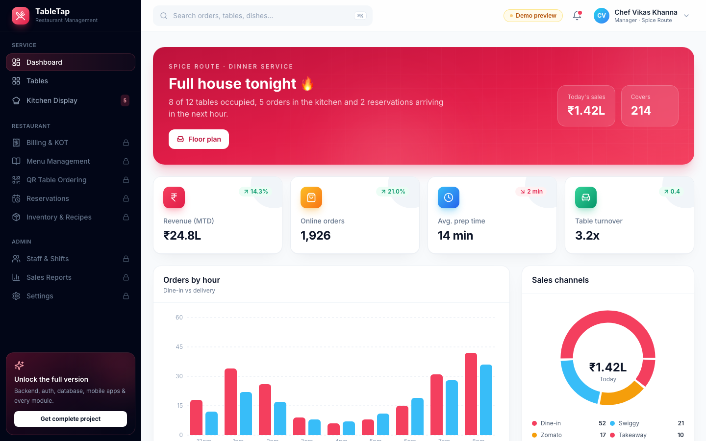
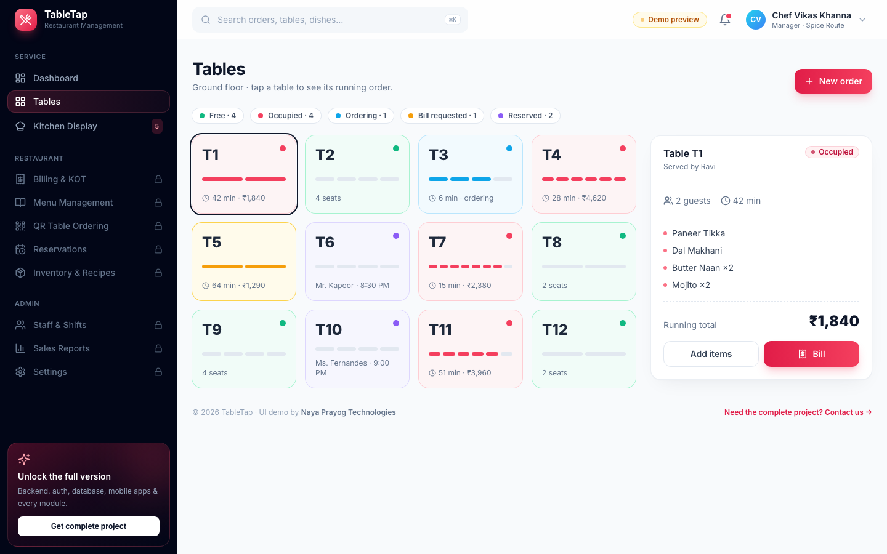
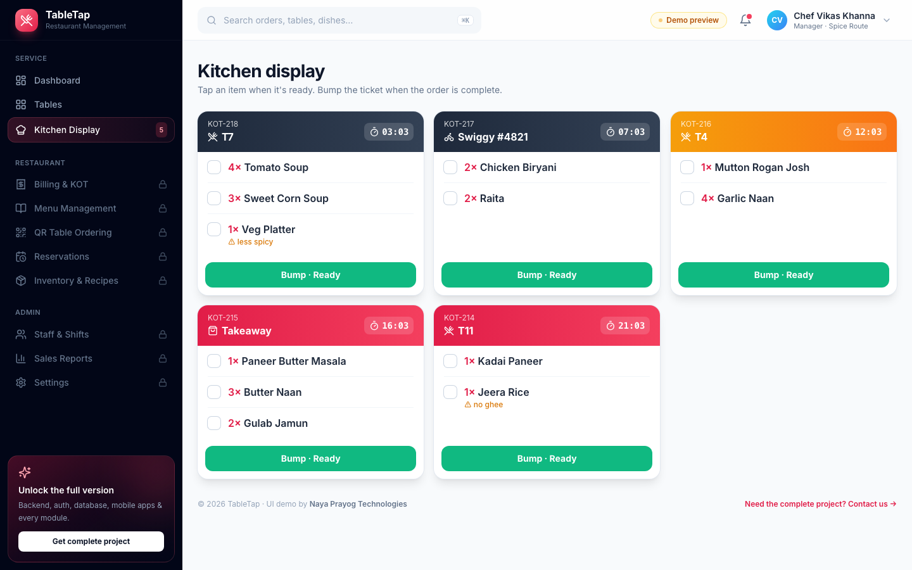

# Restaurant Management Software Development | Custom Restaurant ERP & POS Solutions

**Naya Prayog Technologies** provides custom Restaurant Management Software Development services for restaurants, cafés, hotels, cloud kitchens, food businesses, and multi-outlet restaurant chains.

We help businesses plan and develop integrated restaurant management systems that bring daily operations together — including restaurant orders, table management, menu management, billing, kitchen operations, inventory, staff management, and business analytics.

Whether you operate a single restaurant or manage multiple outlets, we can develop a restaurant management solution tailored to your workflows and business requirements.

---

<!-- screenshots -->
## Screenshots

**Dashboard**

<table>
  <tr>
    <td align="center" width="50%"><b>Tables</b>  </td>
    <td align="center" width="50%"><b>Kitchen</b>  </td>
  </tr>
</table>

---

## Restaurant Management Software Development

A restaurant management system helps restaurant owners manage front-of-house and back-of-house operations through a centralized platform.

Depending on the project scope, a custom restaurant management solution can include:

- Restaurant POS and billing management
- Table and reservation management
- Menu and food item management
- Order management and kitchen workflows
- Inventory and ingredient tracking
- Purchase and supplier management
- Staff and role management
- Customer and loyalty management
- Sales, expenses, and business reports
- Multi-branch restaurant management
- Centralized administration dashboard

Our goal is to develop practical, scalable restaurant software that improves operational visibility, reduces manual work, and supports business growth.

## Key Features and Modules

### 1. Restaurant POS and Billing Management

Manage restaurant billing and payment workflows through a centralized Point of Sale system.

Potential capabilities include:

- Fast order billing and checkout
- Dine-in, takeaway, and delivery order billing
- Item-wise and category-wise billing
- Discounts, taxes, and service charges
- Invoice and receipt generation
- Multiple payment methods
- Split bills and payment handling
- Order cancellation and refund workflows
- Cashier and billing reports

### 2. Table and Reservation Management

Organize dine-in operations and manage restaurant seating.

Potential capabilities include:

- Restaurant floor and table layout
- Table availability status
- Table assignment and transfer
- Table-wise order management
- Reservation and booking records
- Guest and customer information
- Table occupancy tracking

### 3. Menu and Food Item Management

Manage restaurant menus, pricing, and product availability.

Potential capabilities include:

- Food category management
- Menu item creation and editing
- Food descriptions and images
- Pricing and portion management
- Food variants and add-ons
- Customization options
- Item availability scheduling
- Menu management across outlets

### 4. Order and Kitchen Management

Coordinate restaurant orders between service staff and kitchen teams.

Potential capabilities include:

- Dine-in, takeaway, and delivery orders
- Order creation and modification
- Kitchen Order Ticket (KOT) management
- Kitchen display system (KDS)
- Order status tracking
- Preparation status updates
- Order priority management
- Multiple kitchen station workflows
- Completed and pending order tracking

### 5. Inventory and Ingredient Management

Monitor restaurant stock and ingredient consumption.

Potential capabilities include:

- Ingredient and raw material management
- Stock-in and stock-out tracking
- Recipe and ingredient mapping
- Stock consumption records
- Low-stock alerts
- Purchase and supplier records
- Wastage and adjustment tracking
- Inventory valuation and reports

### 6. Purchase and Supplier Management

Organize procurement and supplier operations.

Potential capabilities include:

- Supplier registration and management
- Purchase order management
- Purchase invoices
- Goods receiving records
- Supplier payment tracking
- Purchase history
- Ingredient cost tracking

### 7. Staff and Employee Management

Manage restaurant employees and operational responsibilities.

Potential capabilities include:

- Employee profiles
- Role-based access control
- Cashier and waiter management
- Kitchen staff management
- Shift and duty scheduling
- Attendance records
- Staff performance reports

### 8. Customer and Loyalty Management

Maintain customer information and support repeat business.

Potential capabilities include:

- Customer profiles
- Customer order history
- Loyalty and reward programs
- Promotional offers
- Discount management
- Customer feedback records
- Customer segmentation

### 9. Sales and Business Analytics

Monitor restaurant performance through reports and dashboards.

Potential reports include:

- Daily, weekly, and monthly sales
- Item-wise and category-wise sales
- Order and payment reports
- Revenue and expense summaries
- Inventory and purchase reports
- Staff and cashier performance
- Outlet-wise performance
- Business performance dashboards

### 10. Multi-Branch Restaurant Management

Support restaurant businesses operating across multiple locations.

Potential capabilities include:

- Multiple outlet management
- Outlet-wise menu and pricing
- Branch-level staff management
- Outlet-wise inventory
- Centralized sales reporting
- Branch-level permissions
- Consolidated business dashboards

---

## Types of Restaurant Businesses We Support

We develop restaurant management solutions for different food-service business models:

| Business Type | Potential Solution |
|---|---|
| Restaurants | Complete restaurant management system |
| Cafés and Coffee Shops | Café POS and order management |
| Cloud Kitchens | Kitchen and order management |
| Fast Food Outlets | Quick-service restaurant software |
| Fine Dining Restaurants | Table, reservation, and billing management |
| Food Courts | Multi-counter and outlet management |
| Hotel Restaurants | Restaurant operations and billing |
| Restaurant Chains | Multi-branch restaurant ERP |
| Bakeries | Bakery POS and inventory management |
| Takeaway Businesses | Order and takeaway management |

## Custom Restaurant Software Development

Every restaurant has different operational requirements. We develop custom solutions based on your business model, workflows, and technology requirements.

Our development services can include:

- Custom Restaurant Management Software
- Restaurant POS Software Development
- Restaurant Billing Software
- Restaurant ERP Development
- Kitchen Display System Development
- Restaurant Inventory Management Software
- Table Reservation Software
- Multi-Outlet Restaurant Management
- Restaurant Mobile App Development
- Restaurant Admin Dashboard Development
- Third-Party API and Payment Integrations

## Technology and Development Capabilities

Depending on the agreed project requirements, we can build restaurant management applications using technologies such as:

| Technology | Application |
|---|---|
| Flutter | Android, iOS, and cross-platform applications |
| React / Next.js | Web applications and dashboards |
| Node.js | Backend services and REST APIs |
| Python | Backend development and automation |
| MySQL / PostgreSQL | Relational database management |
| Firebase | Real-time features and application services |
| Cloud Infrastructure | Hosting, deployment, and scalability |

The final technology stack is selected according to the project's performance, infrastructure, integration, and maintenance requirements.

## Why Choose Naya Prayog Technologies?

**Naya Prayog Technologies** is a software development and business automation company focused on building custom digital solutions.

We work with startups, restaurant owners, entrepreneurs, and established businesses to develop software aligned with real operational needs.

What we offer:

- Custom software development
- Web and mobile application development
- Business process automation
- Scalable backend and API architecture
- Admin dashboards and reporting systems
- Third-party service integrations
- Project-specific development and support

**Our objective:** Build restaurant technology that makes business operations more organized, efficient, and measurable.

## Our Development Process

1. **Requirement Analysis** – Understand your restaurant model and operational workflows.
2. **Solution Planning** – Define modules, user roles, and system architecture.
3. **UI/UX Design** – Plan an intuitive interface for restaurant staff and administrators.
4. **Development** – Develop frontend applications, backend services, and database systems.
5. **Testing** – Validate workflows, integrations, and application performance.
6. **Deployment** – Configure hosting and release the agreed applications.
7. **Maintenance** – Provide ongoing improvements and technical support as agreed.

## Frequently Asked Questions

### What is restaurant management software?

Restaurant management software is a digital system that helps restaurants manage operations such as orders, tables, billing, menus, inventory, employees, and business reports.

### Can you develop custom restaurant management software?

Yes. Naya Prayog Technologies develops custom restaurant software based on business requirements, operational workflows, and preferred technology.

### Can restaurant management software include POS billing?

Yes. A restaurant management solution can include POS billing, invoices, payment handling, order management, and sales reporting.

### Can the software support multiple restaurant branches?

Multi-outlet management can be included, with centralized administration, branch-level permissions, outlet-wise reporting, and other capabilities based on the project scope.

### Can you develop Android and iOS applications?

Yes. We can develop cross-platform restaurant applications, staff applications, and customer-facing mobile applications according to project requirements.

### Can restaurant software integrate with online food delivery platforms?

Third-party integrations can be evaluated and developed where the required APIs, access permissions, and provider support are available.

### How much does restaurant management software development cost?

The cost depends on the required modules, number of outlets, user roles, integrations, platforms, and project complexity. Contact our team for a project-specific estimate.

---

## Start Your Restaurant Software Project

Looking for a reliable technology partner to develop custom restaurant management software?

Let's discuss your requirements and build a solution that fits your restaurant business.

**Naya Prayog Technologies**

Website: https://nayaprayog.com/

Portfolio: https://github.helloharendra.io

Email: [support@nayaprayog.com](mailto:support@nayaprayog.com)

Phone / WhatsApp: [+91 7991327022](https://wa.me/917991327022)

**Custom Software Development | Restaurant POS | Restaurant ERP | Web & Mobile Applications | Business Automation**

---

## Repository Purpose

This repository represents the restaurant management software development services and solution capabilities offered by Naya Prayog Technologies.

The features described above are potential development capabilities, not a guarantee that every module is already implemented in a ready-to-deploy product. Final functionality depends on the agreed project scope.

## Proprietary Notice

This repository is maintained by Naya Prayog Technologies for service presentation, portfolio, and business development purposes.

Unless explicitly stated otherwise in a separate written agreement, the materials, branding, documentation, and proprietary content in this repository may not be copied, redistributed, or commercially reused without permission.
